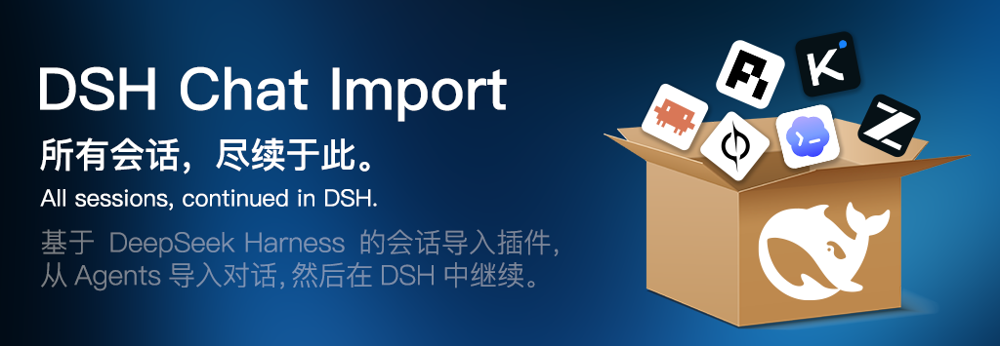
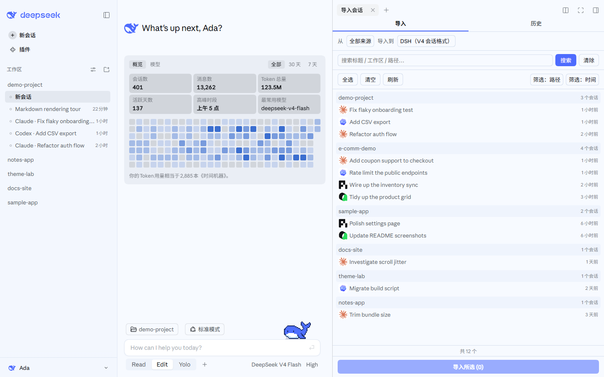
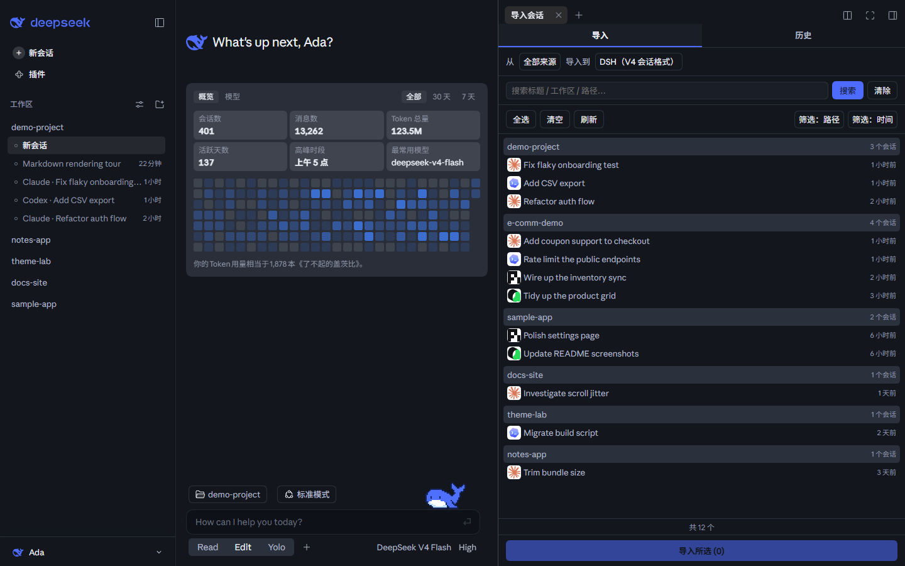

<div align="center">



# DSH Chat Import

**基于 DeepSeek Harness 构建的会话导入插件：把其他 Agent 的聊天历史一键导入，接着在 DeepSeek Harness 里继续对话。**

> **所有会话，尽续于此。**

[](README.md) [](README.zh-CN.md)

[](https://www.npmjs.com/package/dsh-chat-import)
[](https://www.npmjs.com/package/dsh-chat-import)
[](https://github.com/Nwflower/dsh-chat-import)
[](https://gitcode.com/Nwflower/dsh-chat-import)
[](LICENSE)
[](https://awesome-dsh-plugin.com)
[](https://www.dsh.so/artifact/dsh-chat-import/)

</div>


## 支持数据源

<table>
  <tr>
    <td align="center" width="20%"><a href="https://github.com/anthropics/claude-code"><br /><b>Claude Code</b></a></td>
    <td align="center" width="20%"><a href="https://github.com/openai/codex"><br /><b>Codex</b></a></td>
    <td align="center" width="20%"><a href="https://github.com/google-gemini/gemini-cli"><br /><b>Gemini CLI</b></a></td>
    <td align="center" width="20%"><a href="https://github.com/aaif-goose/goose"><br /><b>Goose</b></a></td>
    <td align="center" width="20%"><a href="https://github.com/charmbracelet/crush"><br /><b>Crush</b></a></td>
  </tr>
  <tr>
    <td align="center" width="20%"><a href="https://github.com/qoderAI/qoder-cli"><br /><b>Qoder CLI</b></a></td>
    <td align="center" width="20%"><a href="https://github.com/MoonshotAI/kimi-cli"><br /><b>Kimi CLI</b></a></td>
    <td align="center" width="20%"><a href="https://github.com/MoonshotAI/kimi-code"><br /><b>Kimi Code</b></a></td>
    <td align="center" width="20%"><a href="https://github.com/esengine/DeepSeek-Reasonix"><br /><b>Reasonix</b></a></td>
    <td align="center" width="20%"><a href="https://github.com/anomalyco/opencode"><br /><b>OpenCode</b></a></td>
  </tr>
  <tr>
    <td align="center" width="20%"><a href="https://github.com/XiaomiMiMo/MiMo-Code"><br /><b>MiMo Code</b></a></td>
    <td align="center" width="20%"><a href="https://z.ai"><br /><b>ZCode</b></a></td>
    <td align="center" width="20%"><a href="https://github.com/xai-org/grok-build"><br /><b>Grok Build</b></a></td>
    <td align="center" width="20%"><a href="https://github.com/openclaw/openclaw"><br /><b>OpenClaw</b></a></td>
    <td align="center" width="20%"><a href="https://github.com/Kilo-Org/kilocode"><br /><b>Kilo Code</b></a></td>
  </tr>
  <tr>
    <td align="center" width="20%"><a href="https://github.com/badlogic/pi-mono"><br /><b>Pi Coding Agent</b></a></td>
    <td align="center" width="20%"><a href="https://github.com/can1357/oh-my-pi"><br /><b>oh-my-pi</b></a></td>
    <td align="center" width="20%"><a href="https://github.com/NousResearch/hermes-agent"><br /><b>Hermes</b></a></td>
    <td align="center" width="20%"><a href="https://cursor.com"><br /><b>Cursor</b></a></td>
    <td align="center" width="20%"><a href="https://github.com/cline/cline"><br /><b>Cline</b></a></td>
  </tr>
  <tr>
    <td align="center" width="20%"><a href="https://github.com/continuedev/continue"><br /><b>Continue</b></a></td>
    <td align="center" width="20%"><a href="https://github.com/zed-industries/zed"><br /><b>Zed</b></a></td>
    <td align="center" width="20%"><a href="https://antigravity.google"><br /><b>Antigravity</b></a></td>
    <td align="center" width="20%"><a href="https://chatgpt.com"><br /><b>ChatGPT</b></a></td>
    <td align="center" width="20%"><a href="https://github.com/gabotechs/workbuddy"><br /><b>WorkBuddy</b></a></td>
  </tr>
  <tr>
    <td align="center" width="20%"><a href="https://github.com/QwenLM/qwen-code"><br /><b>Qwen</b></a></td>
    <td align="center" width="20%"><a href="https://github.com/deepseek-ai/deepseek-harness"><br /><b>DSH</b></a></td>
    <td align="center" width="20%"><a href="https://www.teleai.com.cn/product/super-agent"><br /><b>TeleAgent</b></a></td>
    <td align="center" width="20%"><a href="https://www.trae.ai/"><br /><b>Trae Work</b></a></td>
    <td align="center" width="20%"><a href="https://www.doubao.com/download/desktop"><br /><b>豆包</b></a></td>
    <td align="center" width="20%"><a href="https://github.com/mistralai/mistral-vibe"><br /><b>Mistral Vibe</b></a></td>
  </tr>
  <tr>
    <td align="center" width="20%"><a href="#使用"><br /><b>本地 JSONL</b></a></td>
    <td align="center" width="20%"><a href="https://github.com/microsoft/vscode"><br /><b>Copilot VS Code</b></a></td>
    <td align="center" width="20%"><a href="https://github.com/github/copilot-cli"><br /><b>Copilot CLI</b></a></td>
  </tr>
</table>

## 安装

> 插件要求 dsh 0.1.5-rc.1 及以上。已在 0.1.x 与 0.2.0-rc.1 上验证过，其中 dsh-tools 需满足 `>=0.1.0-rc.6 <0.3.0`。

1. 用终端安装

```bash
dsh plugin --profile web add dsh-chat-import                    # npm 包
```

2. 或者从[插件市场](https://github.com/dsh-market/dsh-market)安装

## 使用

1. 通过 GUI 导入会话

  点左侧栏底部的「导入会话」按钮打开导入窗口（用 DSH Claude Style 主题时，这个按钮收在左下角的账号菜单里），选好要导入的会话，一键导入。

  会话行自带工具：**双击**行打开只读预览（跑的是导入的 dry-run，插件注入的消息不出现，工具调用折成一行）；搜索框可切到「**搜内容**」按正文检索；可以把行**隐藏**（可撤销）；可以把单会话来源的文件移进回收站；也可以把行**拖到左侧栏的工作区**上，导入到那个工作区并把时间轴平移到「现在」，让它排在最上面。规则细节见 [docs/USAGE.zh-CN.md](docs/USAGE.zh-CN.md)。

  手上是别的工具导出的文件（网页版导出、自己写的脚本、列表里没有的工具）时，用同一个窗口顶部的「**从文件导入**」：填本机路径后回车，或者点「**选择…**」挑文件。路径是目录时会先问你要不要搜索子文件夹。预览确认之后再导入。识别不出格式时，会逐个列出候选解析器的失败原因，并给出把该格式转换过来的 Skill 指引。

  <table>
    <tr>
      <td align="center" width="50%"></td>
      <td align="center" width="50%"></td>
    </tr>
  </table>

  > 截图界面用的是作者另一个主题插件 [DSH Claude Style](https://github.com/Nwflower/dsh-claude-style) 的 DeepSeek 配色。它在 DSH 里复刻了 Claude Code Desktop 的视觉与交互，提供 Claude、DeepSeek 两套配色；看惯了默认主题的话可以试试。截图里的工作区与会话都是示例数据。

2. 让 Agent 调用工具导入

```
# 参考调用格式
import_chat({ format: "claude", path: "~/.claude/projects" })
import_chat({ format: "chatgpt", path: "~/Downloads/chatgpt-export/conversations.json" })
import_chat({ format: "local-jsonl", path: "D:\downloads\session.jsonl" })
```

## 配置

为了照顾 TUI 用户，插件提供的工具默认会注入上下文。你可以在设置页里把它们设成**不注入**或**只注入一部分**，这样能省下不少 token。

每个工具、每条命令的完整用法见 **[docs/USAGE.zh-CN.md](docs/USAGE.zh-CN.md)**。

第三方插件可以通过可选的 `chatImport` Host Service 调用 `scanDiscover()`、`importPath()`、`importAll()` 和 `resumeSummary()`。这四个方法复用与工具、命令相同的发现、导入、批量导入与交接摘要管线；单会话导入的返回值带 `sessionId`。服务不存在时，调用方要自己降级。

## 功能一览

| 能力 | 入口 | 说明 |
| --- | --- | --- |
| 导入 | 侧边栏面板的「导入」页 | 从其他 Agent 导入对话，保留推理过程、工具调用结果和系统提示词（可选） |
| 文件导入 | 面板「从文件导入」/ `/import auto <path>` | 任意本地文件或目录：三级探测（显式格式 > 内容标记 > 逐格式试跑）、预览先行、目录会问要不要搜索子文件夹。识别失败时摊开各解析器的原因，一键复制可直接发给 Agent 的任务模板，并注册 `dsh-chat-import-convert` 转换 skill |
| 撤回导入 | 侧边栏面板的「历史」页 | 查看导入记录，一键删除本插件创建的会话 |
| 导出 | 上下文工具 | 把 DSH 会话序列化回外部 Agent 的格式 |
| 忽略 | 自动登记 + `/ignores` 命令 | 归档、删除、删工作区时自动登记源，重扫时跳过；用 `/ignore`、`/unignore` 管理忽略表 |

Codex 的会话标题优先取 `session_index.jsonl` 里保存的标题（`thread_name`），所以 Codex 里改过的名字也能显示。没有索引标题时，才按与导入共用的提取逻辑回退到首条真实提问，并排除注入的页面上下文。标题索引按行流式读取，同一会话取最后一条有效记录。

Codex 的活动时间取日志头尾有界窗口里最新的有效时间戳，并合并所有 rollout 分页的结果。只有日志里完全没有时间时才回退文件修改时间，所以宿主文件服务不提供修改时间也能取到活动时间。被窗口截断的记录里的时间戳可能漏掉。

Claude Code 的 fork 会话（新版桌面端会话菜单与 `--fork-session`）同样会被发现并导入。fork 转录把父会话的记录逐字拷贝在文件开头，自己的记录从 fork 点开始追加。所以判定主转录时看文件的两端：文件名 stem 出现在头部或尾部，就算这个文件自己的会话。会话身份取转录里最后出现的 `sessionId`。以前这类文件被整类当成子代理辅助转录跳过，一条都扫不到。拷贝过来的父会话历史会留在日志里，因为 fork 的上下文本来就有它，于是父会话与 fork 会话会重叠一段历史。

Hermes 在 Windows 上默认扫描 `%LOCALAPPDATA%\hermes` 与 `~/.hermes`；`LOCALAPPDATA` 没有设置时，回退到 `~/AppData/Local/hermes`。macOS 与 Linux 默认扫描 `~/.hermes`。

## 文档

| 文档 | 说明 |
| --- | --- |
| [使用详解](docs/USAGE.zh-CN.md) | 每个工具、每条命令的完整参数、示例与边界行为 |
| [互转协议](docs/INTERCHANGE.md) | Interchange v1 协议与 bundle 格式 |
| [转换指南](docs/INTERCHANGE-GUIDE.zh-CN.md) | 给 Agent 的 Skill 指令：把任意转录转成可导入的 interchange v1 文档 |
| [导入指南](docs/IMPORT-GUIDE.zh-CN.md) | 给 Agent 的 Skill 指令：`import_chat` 的来源格式表、参数详解与重导规则 |
| [设置页迁移](docs/SETTINGS-MIGRATION.zh-CN.md) | DSH 0.1.5 → 0.1.7 插件设置页迁移（实测报错、兼容写法） |
| [更新日志](CHANGELOG.md) | 版本历史（英文） |
| [路线图](docs/ROADMAP.md) | 未完成、计划与明确不做的事项 |
| [贡献指南](docs/CONTRIBUTING.md) | 开发环境、提交规范、安全与隐私 |

## 友链

> 只需要迁移**配置**（技能、hooks、全局设置等）、不需要会话历史的话，推荐用 [dsh-movein](https://github.com/sjh9714/dsh-movein)。

## Star History

[](https://www.star-history.com/?type=date&repos=Nwflower%2Fdsh-chat-import)
